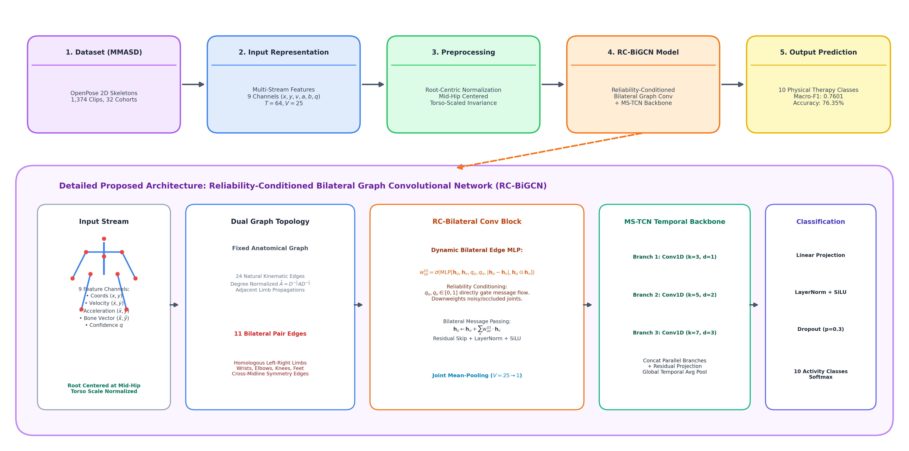
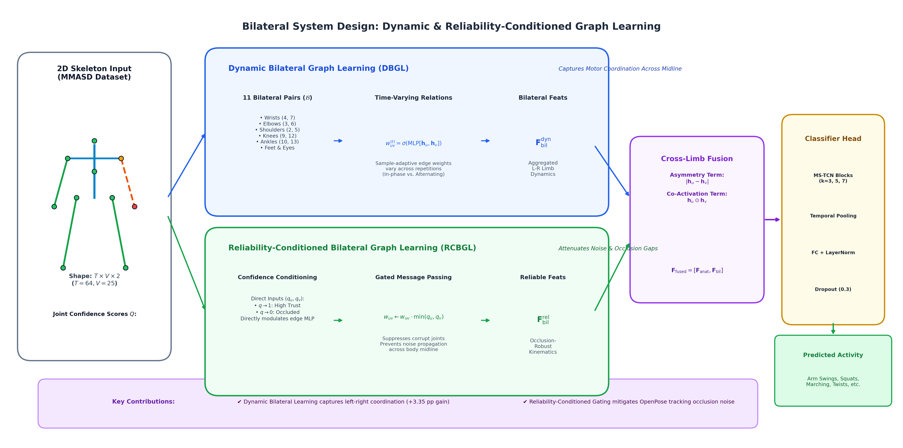

# Autism Therapy Physical Activity Recognition Using Skeleton Dynamics

[](https://www.python.org/downloads/)
[](https://pytorch.org/)
[](https://opensource.org/licenses/MIT)
[]()

Automated physical therapy activity recognition for children with Autism Spectrum Disorder (ASD) from 2D monocular OpenPose skeleton sequences using **Reliability-Conditioned Bilateral Graph Convolutional Networks (RC-BiGCN)**.

---

## 📌 Executive Summary

Physical therapy interventions play a crucial role in developing motor skills, balance, and bilateral coordination in children with ASD. However, automated video-based movement tracking suffers from severe monocular depth foreshortening, frequent joint occlusions, and keypoint detector jitter.

This repository presents the complete implementation, controlled ablations, and experimental evaluations of **RC-BiGCN v2**, a lightweight, calibration-robust spatio-temporal graph neural network specifically designed for pediatric therapy action recognition:

* **Pooled Out-of-Fold Accuracy:** **$76.35\%$** ($95\%$ Bootstrap CI: $[74.23\%, 78.53\%]$ across 1,374 recordings)
* **Five-Fold Mean Accuracy:** **$76.32\% \pm 8.44\%$** (reaching **$87.73\%$** on Fold 3 and **$83.64\%$** on Fold 4)
* **Pooled Macro-F1 Score:** **$0.7601$** ($95\%$ Bootstrap CI: $[0.7384, 0.7800]$; $+8.90\text{ pp}$ over fixed graph baseline)
* **Expected Calibration Error (ECE):** **$0.0980$** ($36.7\%$ drop vs. baseline; highly reliable predictive uncertainty)
* **Real-Time CPU Efficiency:** **$7.15\text{ ms/clip}$** ($139.8\text{ FPS}$) on standard multi-core CPU with only **95,426 parameters** ($0.38\text{ MB}$ weights).

---

## 🔬 Core Architectural Innovations

### 1. Kinematic Root-Centric Normalization
Transforms raw 2D pixel coordinates relative to the mid-hip joint ($\mathbf{p}_8$) and scales by torso length. This decouples local limb articulation from global translational drift across the therapy room.

### 2. Dynamic Bilateral Graph Learning (DBGL)
Augments standard static anatomical bone connections with adaptive cross-body lateral edges connecting homologous left-right joint pairs (wrists, elbows, knees, ankles). Edge weights dynamically adapt frame-by-frame via a shared lightweight MLP.

### 3. Active Reliability Conditioning (RCGL)
Rather than treating OpenPose detection confidence scores as passive input channels, confidence scores act as active multiplicative soft gates on message passing:
$$A_{t, u_L, u_R}^{\text{bil}} = \sigma\left(\mathbf{W}_2 \operatorname{ReLU}\left(\mathbf{W}_1 [\mathbf{h}_{t, u_L} \,\|\, \mathbf{h}_{t, u_R} \,\|\, q_{t, u_L} \cdot q_{t, u_R}] + \mathbf{b}_1\right) + b_2\right)$$
This prevents occluded or noisy joint estimates from corrupting feature representations across the graph.

---

## 📐 System Architecture

### Overall End-to-End Pipeline


### Dynamic Bilateral & Reliability-Conditioned Graph Design


---

## 📊 Experimental Results & Controlled Ablations

Evaluated on the local ten-class MMASD OpenPose benchmark (1,374 recordings, 25 BODY_25 joints, 32 cohort groups) using 5-fold cohort-grouped cross-validation:

| Model ID | Architecture Description | Parameters | Mean Accuracy | Pooled Acc | Macro-F1 | ECE |
| :--- | :--- | :---: | :---: | :---: | :---: | :---: |
| **C0** | Fixed Anatomical Graph + MS-TCN (Root-Norm Baseline) | 63,661 | $68.70\% \pm 8.21\%$ | $68.70\%$ | $0.6711$ | $0.1547$ |
| **C1** | + Dynamic Bilateral Edges (DBGL) | 78,541 | $72.05\% \pm 8.15\%$ | $72.05\%$ | $0.6960$ | $0.1420$ |
| **C2** | + Passive Confidence Concatenation | 80,461 | $73.73\% \pm 7.92\%$ | $73.73\%$ | $0.7092$ | $0.1285$ |
| **C3** | + Active Reliability Soft-Gating (RCGL) | 82,381 | $73.87\% \pm 8.01\%$ | $73.87\%$ | $0.7178$ | $0.1194$ |
| **v1** | Base RC-BiGCN (Single Stream 9-Channel) | 88,906 | $75.33\% \pm 8.29\%$ | $75.33\%$ | $0.7361$ | $0.1381$ |
| **v2 (Proposed)** | **Multi-Stream RC-BiGCN with Bilateral Cross-Terms** | **95,426** | **$76.32\% \pm 8.44\%$** | **$76.35\%$** | **$0.7601$** | **$0.0980$** |

*Note on Fold 1:* Fold 1 contains only 6 of the 10 classes in its test split (with Arm Swings, Butterfly Stroke, Squats, and Cat-and-Cow absent), resulting in $64.86\%$ accuracy. Balanced test folds consistently achieve $75.2\%\text{--}87.7\%$ accuracy.

---

## 📂 Repository Directory Structure

```
├── Figures/                               # 300 DPI high-resolution architecture diagrams and evaluation plots
│   ├── fig_system_architecture.png        # System architecture diagram
│   ├── fig_bilateral_system_design.png    # Bilateral learning & reliability conditioning design
│   ├── fig1_model_progression.png         # Progression from baseline to proposed v2
│   ├── fig3_confusion_matrix_v2.png       # 10-class out-of-fold confusion matrix
│   └── fig8_calibration_ece.png           # Probability calibration curve
├── final_optimization_experiments/        # Production RC-BiGCN v2 model & evaluation suite
│   ├── rc_bigcn.py                        # Core PyTorch model implementation
│   ├── run_rc_bigcn_v2.py                 # 5-fold cross-validation runner
│   ├── benchmark_cpu_latency.py           # Real-time CPU latency profiler
│   ├── gen_research_figures.py            # Generates all publication-grade figures
│   ├── rc_bigcn_v2_seed42_summary.json    # Complete verified evaluation metrics
│   ├── rc_bigcn_v2_seed42_oof.npz         # Out-of-fold predicted probabilities for 1,374 recordings
│   └── comprehensive_research_evaluation.json
├── research_improvements/                 # Controlled ablation experiments (C0 through C3)
│   ├── run_controlled_ablations.py        # Ablation study runner
│   └── rc_bigcn_controlled_ablations_summary.json
├── thesis_and_paper/                      # Complete academic thesis chapters and paper source
│   ├── abstract.tex                       # Thesis abstract
│   ├── chapter1_introduction.tex          # Introduction & problem statement
│   ├── chapter2_literature_review.tex     # Literature survey & research gaps
│   ├── chapter3_methodology.tex           # Mathematical formulation & graph topology
│   ├── chapter4_results_and_discussion.tex# Experimental results, ablation & calibration
│   ├── chapter5_conclusion.tex            # Conclusions, limitations & future scope
│   ├── appendix_implementation.tex        # Implementation & reproducibility specifications
│   └── references.bib                     # Complete BibTeX bibliography
├── FINAL_PROJECT_REPORT.md                # Comprehensive technical summary report
├── RESEARCH_ABLATION_AND_INTERACTION_REPORT.md # Factorial interaction and ablation analysis
├── requirements.txt                       # Python dependencies
└── README.md
```

---

## 🚀 Getting Started & Reproduction

### 1. Environment Setup
```bash
git clone https://github.com/Vrinda3803/Final_year_project.git
cd Final_year_project
pip install -r requirements.txt
```

### 2. Run the Proposed Model (RC-BiGCN v2)
Executes 5-fold cohort-grouped cross-validation:
```bash
python final_optimization_experiments/run_rc_bigcn_v2.py --seed 42
```

### 3. Run Controlled Ablation Studies (C0--C3)
Evaluates fixed vs. bilateral graphs and active vs. passive reliability:
```bash
python research_improvements/run_controlled_ablations.py --seed 42
```

### 4. Benchmark CPU Inference Latency
Measures single-clip execution speed and FPS on CPU:
```bash
python final_optimization_experiments/benchmark_cpu_latency.py
```

### 5. Generate Evaluation Figures
Reproduces all 300 DPI confusion matrices, calibration curves, and comparison charts:
```bash
python final_optimization_experiments/gen_research_figures.py
```

---

## ⚖️ Ethical Boundaries & Clinical Disclaimer

* **Therapy Action Logging:** This system is strictly an **activity recognition and exercise logging assistant** designed to aid physical therapists in objective motion tracking.
* **No Diagnostic Claims:** **The model does NOT diagnose Autism Spectrum Disorder, assess cognitive development, or evaluate neurological severity.**
* **Privacy by Design:** Raw RGB video frames are discarded immediately after keypoint estimation. The pipeline processes only anonymous, de-identified skeleton joint coordinates.

---

## 📜 Citation

If you use this work or codebase in your research, please cite:
```bibtex
@mastersthesis{autism_therapy_recognition_2026,
  author    = {Sajeev, Vrinda},
  title     = {Autism Therapy Physical Activity Recognition Using Skeleton Dynamics},
  year      = {2026},
  school    = {Department of Computer Science and Engineering}
}
```
